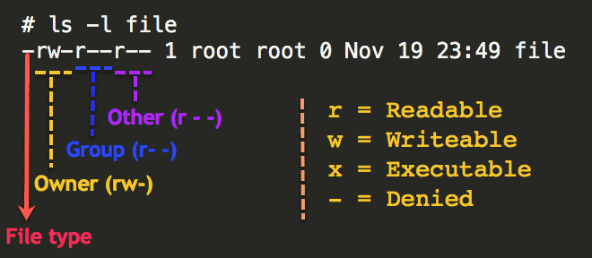

# Access Control
## File Permissions and Ownership

Linux divides file permissions into read (`r`), write (`w`), and execute (`x`) permission categories. 

| Letter | Name | More detail |
|-|-|-|
| `r` | read    | Read permission allows viewing or copying file contents (or listing a directory's contents). |
| `w` | write   | Write permission allows modifying file contents (or creating and deleting files in a directory). |
| `x` | execute | Execute permission allows running a file as a program (or entering a directory). | 

These three permissions are defined for each of the three owner types typically referred to as User (`u`), Group (`g`), and Others (`o`). 

| Letter | Name | More detail |
|-|-|-|
| `u` | user    | User is a single user who owns the file. |
| `g` | group   | Group is a collection of users who can access the file. |
| `o` | other | Consists of all the users on the system. | 

!!! note
	Only the owner of a file or directory can change its permissions, or change its group to one of the owner's groups.

For example, to check the file access permissions of `myfile.dat`, run the `ls -l` command: 

```
$ ls -l myfile.dat
```
we get: 
```
-rw-r--r-- 1 jdoe pi-drpepper 8444 Feb 20 12:49 myfile.dat
```
Here is how we interpret the symbols on the left. First, we break it into four parts: 
`-` `rw-` `r--` `r--` 

`- (part 0)` `rw- (part 1)` `r-- (part 2)` `r-- (part 3)` 

* `rw- (part 1)` means the file owner (`jdoe`) can read and modify (write) this file. 
* `r-- (part 2)` means the group members of `pi-drpepper` can only read this file but not modify it. 
* `r-- (part 3)` means others who are not part of the group can also read this file. 

<p align="center">

</p> 

To set up user permissions to a folder recursively, you can run the following command in the absolute mode, providing three [permission bits](https://www.guru99.com/file-permissions.html#absolute_mode_in_linux){:target='_blank'} for the User (7), Group (5), and Others (5): 
```
$ chmod -R 755 myfolder
```
where 7=4+2+1 (`rwx` for User), 5=4+0+1 (`r-x` for Group), and 5=4+0+1 (`r-x` for Others). This is equivalent to the following command in symbolic mode: 
```
$ chmod -R u=rwx,go=rx myfolder
```
where, unlike the absolute mode, users can override (`=`), add (`+`), or remove (`-`) all or selected permissions for the owner (`u`), group (`g`), or others (`o`).

Summary of the default file system permissions of the most commonly used directories on RCC clusters:

| Directory              | Permissions    | Permissions bits                         |
|------------------------|----------------|------------------------------------------|
| `$HOME`                | drwx------     | `700` – Accessible only to the owner     |
| `$SCRATCH`             | drwx------     | `700` – Accessible only to the owner     |
| `/project/drpepper` | drwxrws---     | `770` – Read/write for the project group |
| `/project2/drpepper` | drwxrws---     | `770` – Read/write for the project group |
| `/dali/drpepper` | drwxrws---     | `770` – Read/write for the project group |

When new files or directories are created, the `umask` influences the default permissions of those files and directories.  The default value of `umask` is set to `0002`, which means that newly created files will have permissions of 664 (`-rw-rw-r--`) and newly created directories will have permissions of 775 (`drwxrwxr-x`). 

In your home directory, the group owner will be set to your personal user group, the same as your CNetID, so you will still be the only user to access your files and directories. 

Note that project directories are owned by the PI's group (e.g., `pi-drpepper`) and have the setgid bit set, i.e., a mode of 2770 (`drwxrws---`). The extra bit `2` is shown as `s` in place of the group `x` permission. It makes new files and subdirectories created inside the directory inherit the directory's group instead of the creator's personal group. 

Here is an example of what this means in practice:

```default
$ ls -ld $HOME 
drwx------ 108 jdoe jdoe 32768 2013-01-15 10:51 /home/jdoe
```

```
$ ls -ld /project/drpepper
drwxrws---  3 drpepper      pi-drpepper 32768 2013-01-15 10:48 /project/drpepper
```

Let's check this with an example. Using `touch`, we create two identical files, one in our home and the other under `drpepper`'s project directory. 
```
$ touch $HOME/newfile /project/drpepper/newfile
```

Now, let's compare the permissions of these two files: 
```
$ ls -l /project/drpepper/newfile $HOME/newfile
-rw-rw-r-- 1 jdoe jdoe			0 2023-01-01 00:00 /home/jdoe/newfile
-rw-rw-r-- 1 jdoe pi-drpepper 0 2023-01-01 00:00 /project/drpepper/newfile
```

Both files are readable and writable by the group owner due to the default `umask`, but the group owners differ due to the setgid bit being set on `/project/drpepper`. This applies only to newly created files and directories. Files or directories moved from elsewhere keep their original ownership and permissions.

To change the group ownership of a directory and its contents, you can use `chgrp -R`: 

```
$ chgrp -R pi-drpepper myfolder
```
This will change the group owner of all of the files and folders under the `myfolder` directory. 
```
$ ls -l myfolder
-rwxrwxr-x 1 jdoe pi-drpepper 0 Feb 20 12:49 myfile.dat
-rwxrwxr-x 1 jdoe pi-drpepper 0 Feb 20 12:51 myfile2.dat
```

!!! warning "Locked out"
      If you need our help to overwrite the file permission of a directory, please reach out to us. Remember, the account owner can ask for this only for files under `/home` and `/scratch`; only PIs can request this for files under their group-shared directories. 

## Sharing Data with a Group Member
Suppose there is a folder tree as below, and you want to make the folder `my_folder` accessible only to the user `drwho`, who is already a member of your group `pi-drpepper`:

```default
/project2/drpepper
   |- my_folder
   |- other_stuff
```

Before using ACL, you need to confirm that this folder is open to all members of the group `pi-drpepper`:

```default
$ cd /project2/drpepper
$ chgrp -R pi-drpepper my_folder
```
And, 
```
$ cd /project2
$ chmod -R 770 drpepper
$ cd drpepper
```

At this point, the folder `drpepper` is readable and writable by all members of the group `pi-drpepper`. Then, you can use the `setfacl` command to precisely control individual users' access. First, you need to remove the default group access by ACL:

```default
$ setfacl -m g::--- my_folder
```

Although the command `ls -l` will still display group `rwx` access for the `my_folder` folder in the Linux-based permissions, users cannot access it anymore due to the permission set by ACL. Then, you can grant the user `drwho` access to the folder:

```default
$ setfacl -m u:drwho:rwx my_folder
```

At this step, the user `drwho` has both read and write permissions to the folder `my_folder`. You can set up permissions for each user the way you want.

To view the list of configured accesses on the folder `my_folder`, run:

```default
$ getfacl my_folder
# file: my_folder
# owner: jdoe
# group: pi-drpepper
user::rwx
user:drwho:rwx
group::---
mask::rwx
other::---
```

To revoke the user `drwho`'s permissions on the folder:

```default
$ setfacl -x u:drwho my_folder
```

To clean up (remove) all ACL entries on the folder:

```default
$ setfacl -b my_folder
```

## Sharing Data with a Collaborator

Suppose you would like to share your folder `/project2/drpepper/my_own_folder/shared_data` with another RCC user with CNetID `drj`, who is not in your group `pi-drpepper`. As the folder owner, you can execute the following two commands.
```
setfacl -Rm d:u:drj:rw-,u:drj:rw- /project2/drpepper/my_own_folder/shared_data
setfacl -m u:drj:--x /project2/drpepper/my_own_folder
```
The first command changes the ACL permission of the folder (and recursively its sub-folders and files) to allow the user `drj` to read and write. The second command adds execute permission to `drj` so that `drj` can access the parent folder `/project2/drpepper/my_own_folder` without read or write permissions. 

   
## Advanced Access Control via ACL
Access control list [(ACL)](https://www.redhat.com/sysadmin/linux-access-control-lists){:target='_blank'} provides an additional, more flexible permission mechanism for file systems. It complements standard UNIX file permissions. ACL allows you to give permissions on any file or directory to any user or group. For more information, please visit the <a href='https://wiki.archlinux.org/title/Access_Control_Lists' target='_blank'>ACL documentation</a>.


The default Linux file permission management covered in the previous section only supports the permissions at the owner/group/others level. ACL provides more precise control over any data (files or directories) customizable for individual users or groups. Before applying ACL to your data, please read and understand the following caveats. 

* By default, no ACL is set for user data. ACL provides highly flexible permission control but also increases the complexity of managing user access. PIs normally want to share an entire project folder with all group members; for this, the Linux-based permissions are enough. We suggest that users implement ACL controls only when necessary. One example is to protect confidential data in the project space by allowing only certain users to access confidential directories or files.


* After ACL is set, Linux-based and ACL permissions will work together as a dual-guard system. The final effective access to data is granted only if permitted by both mechanisms. For example, if a folder is group-accessible to a user by Linux-based permission but restricted by ACL, the user cannot access this folder.


* Be sure you are comfortable setting up access via Linux-based permissions and ACL, i.e., you understand what “users”, “groups,” and each attribute in `rwx` mean and how to use them. Otherwise, please [contact our Help Desk](https://rcc.uchicago.edu/support-and-services/consulting-and-technical-support){:target='_blank'} for assistance managing your data access. We are here and happy to help you set up the permissions to keep your data safe and accessible as required.

